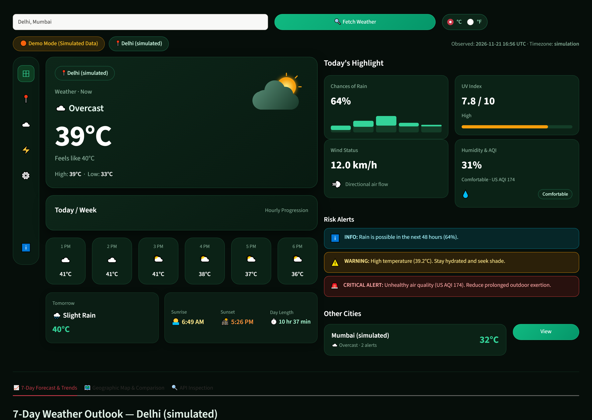
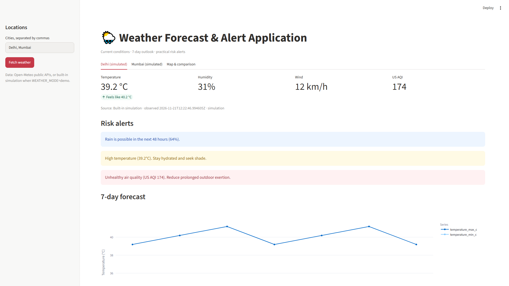
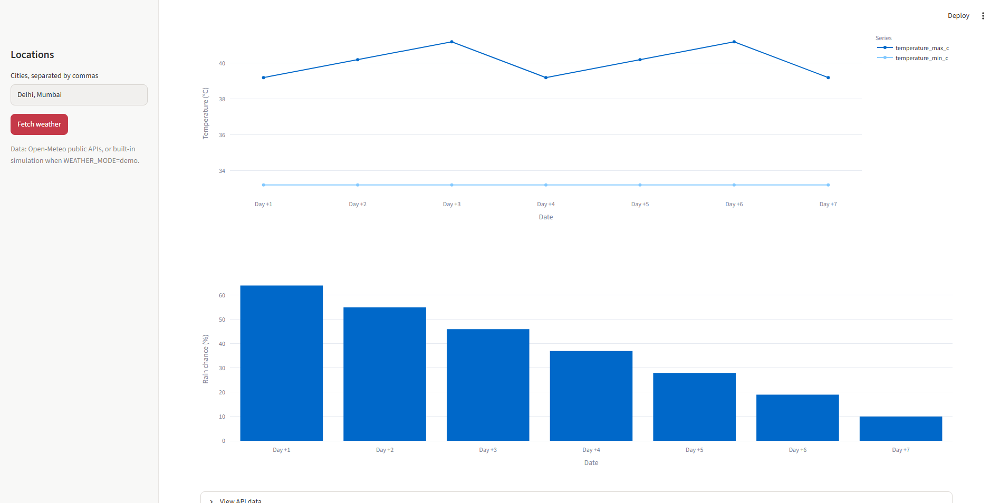
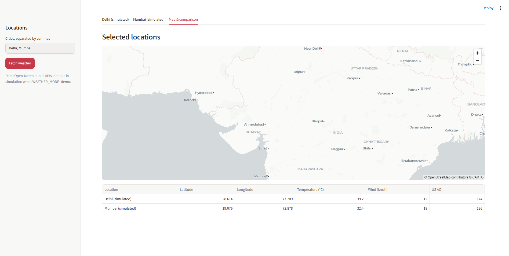
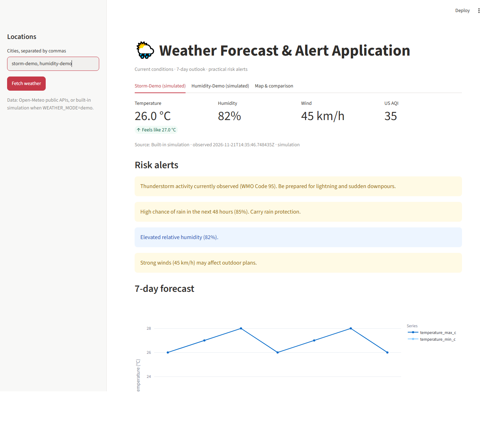
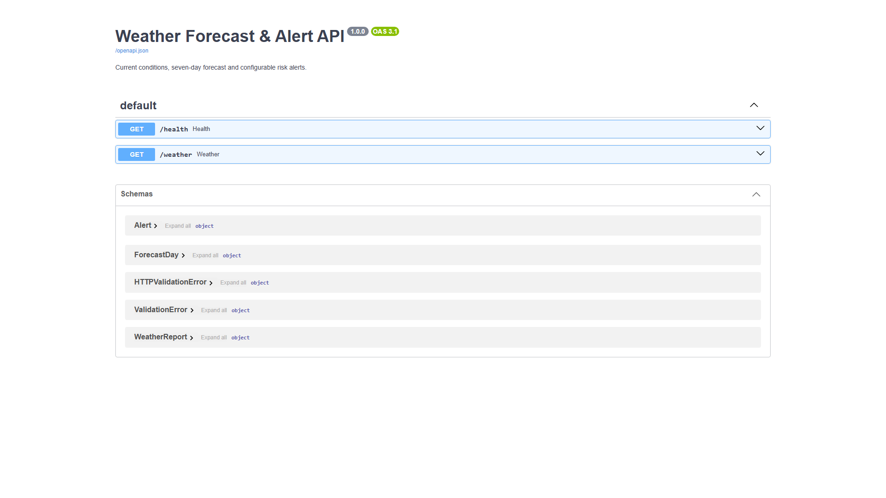

# Weather Forecast & Alert Application

A Python portfolio project that combines public weather APIs, a typed FastAPI service, configurable risk rules, an offline simulator, and an interactive Streamlit dashboard.

## Features

- City-name lookup through Open-Meteo Geocoding, followed by current conditions and a seven-day forecast.
- Optional current air quality (US/EU AQI and particulate matter when the provider supplies it).
- Rain, heat, wind, humidity, storm, and AQI risk alerts with severity and transparent starter thresholds.
- Multi-city API requests, interactive temperature and precipitation charts, a map, and readable notifications.
- Built-in deterministic simulation for offline demos and screenshots; simulation is explicitly labelled.
- FastAPI OpenAPI documentation at `/docs`.

### Risk Alert Rules & Starter Thresholds

The alert engine evaluates current conditions and the near-term 48-hour forecast against starter thresholds. Humidity thresholds can be changed in `.env` with `HUMIDITY_ELEVATED_THRESHOLD` and `HUMIDITY_HIGH_THRESHOLD`; the other thresholds are currently defined in `src/weather_alert/alerts.py`.

| Risk Category | Severity | Condition / Trigger | Message / Guidance |
| --- | --- | --- | --- |
| **Storm** | Critical | WMO code 96 or 99 (Thunderstorm with slight/heavy hail) in current or near-term forecast | Severe thunderstorm with hail warning; seek secure indoor shelter |
| **Storm** | Warning | WMO code 95 (Thunderstorm: slight or moderate) in current or near-term forecast | Thunderstorm activity alert; prepare for lightning and downpours |
| **Rain** | Warning | Precipitation probability >= 70% in next 48 hours | High chance of rain; carry rain protection |
| **Rain** | Info | Precipitation probability >= 40% in next 48 hours | Rain is possible in the next 48 hours |
| **Heat** | Critical | Current temperature >= 40.0°C | Very high temperature; limit strenuous outdoor activity |
| **Heat** | Warning | Current temperature >= 35.0°C | High temperature; stay hydrated and seek shade |
| **Humidity** | Warning | Current relative humidity >= `HUMIDITY_HIGH_THRESHOLD` (default 85%) | Very high relative humidity; oppressive, muggy conditions |
| **Humidity** | Info | Current relative humidity >= `HUMIDITY_ELEVATED_THRESHOLD` (default 75%) | Elevated relative humidity |
| **Wind** | Critical | Current wind speed >= 60 km/h | Very strong winds; secure loose outdoor items |
| **Wind** | Warning | Current wind speed >= 40 km/h | Strong winds may affect outdoor plans |
| **Air Quality** | Critical | US AQI >= 151 | Unhealthy air quality; reduce prolonged outdoor exertion |
| **Air Quality** | Warning | US AQI >= 101 | Air may affect sensitive groups |
| **Status** | Info | No conditions crossed configured thresholds | Status confirmation that conditions are within normal limits |

## Architecture

```text
Streamlit dashboard ──HTTP──> FastAPI ──> Open-Meteo Geocoding / Forecast / Air Quality
                                      └──> deterministic demo provider (offline)
```

## Application Screenshots

*All screenshots captured directly from the verified running application in offline demo mode (`WEATHER_MODE=demo`).*

### Redesigned Dark Emerald Dashboard

*Redesigned Streamlit interface featuring a near-black canvas, deep emerald-green cards, navigation rail, main weather summary, today's highlights (rain, UV, wind, humidity, AQI, risk alerts), hourly progression, sun timeline, and multi-city comparison.*

### Dashboard Overview

*Current weather metrics (temperature, humidity, wind speed, US AQI) and threshold-triggered risk alerts.*

### 7-Day Forecast & Precipitation Breakdown

*Interactive 7-day temperature trends and daily precipitation probability bar chart.*

### Map & Location Comparison

*Geographic map markers and tabular side-by-side comparison for queried locations (Delhi and Mumbai).*

### Storm & Humidity Alerts (Demo Mode)

*Demo-mode alerts for `storm-demo` and `humidity-demo` cities: warning-level thunderstorm (WMO Code 95), high rain probability, and oppressive humidity alert (92%). Values are fixed simulation presets; live weather will differ.*

### Interactive OpenAPI Documentation

*FastAPI Swagger UI at `/docs` displaying typed `/health` and `/weather` schemas.*

## Run locally (Windows PowerShell)

```powershell
py -3.11 -m venv .venv
.\.venv\Scripts\Activate.ps1
python -m pip install -r requirements.txt
Copy-Item .env.example .env
uvicorn main:app --reload
```

Open <http://127.0.0.1:8000/docs> to explore the API. In another terminal, activate the same environment and run:

```powershell
streamlit run dashboard.py
```

The dashboard opens in a browser. Enter one or more cities and select **Fetch weather**.

### Offline simulation

Set `WEATHER_MODE=demo` in `.env`, restart Uvicorn, and use cities such as Delhi, Mumbai, London, or New York. To exercise specific alert rules, use `storm-demo`, `severe-storm-demo`, or `humidity-demo`. The simulator returns repeatable sample values and labels the source as simulated. Other names receive a generic simulated location. Return to `WEATHER_MODE=live` for real provider data.

## API examples

```text
GET /health
GET /weather?cities=Delhi&cities=Mumbai
```

Response is an array of reports. Each report contains location coordinates, observation time, current values, optional AQI, seven daily forecast records, and generated alerts. Try `/docs` for the complete interactive schema.

## Data sources and limitations

The live mode uses [Open-Meteo Geocoding](https://open-meteo.com/en/docs/geocoding-api), [Forecast](https://open-meteo.com/en/docs), and [Air Quality](https://open-meteo.com/en/docs/air-quality-api) endpoints. No API key is needed for this learning project. Check the provider's current terms and attribution requirements before public or commercial deployment. Provider data is subject to availability and coverage; AQI can be absent. This app is an educational demonstration, not an official warning service. Thresholds are illustrative defaults and should be reviewed for the intended region and audience.

## Project structure

```text
Weather-Forecast-Alert-Application/
├── data/                 # Small sample inputs (live data is fetched, not stored here)
├── src/weather_alert/    # API, provider integration, schemas, configuration, alert rules
├── outputs/              # Future generated exports; current app writes no files
├── images/               # Genuine screenshots and diagrams
├── reports/              # Report examples or supporting project notes
├── docs/                 # Detailed project explanation and design documentation
├── dashboard.py          # Streamlit visualization and notifications
├── main.py               # ASGI entry point used by Uvicorn
├── requirements.txt
├── .env.example
├── .gitignore
└── README.md
```

### Folder Explanations

- **`data/`** — Stores small, curated sample inputs. Live weather data is retrieved on demand and is not cached or persisted here.
- **`src/`** — Application source tree. The backend is implemented under `src/weather_alert/` containing FastAPI routes, Open-Meteo clients, Pydantic schemas, and risk assessment rules.
- **`outputs/`** — Reserved for future export files (e.g., CSV/JSON summaries). The current service writes no files here.
- **`images/`** — Dedicated storage for genuine application screenshots and architecture diagrams.
- **`reports/`** — Holding location for report examples, summary notes, or export artifacts.
- **`docs/`** — Comprehensive architectural, structural, and conceptual documentation (`FOLDER_STRUCTURE.md`, `PROJECT_EXPLANATION.md`).

Folder responsibilities and detailed file roles are also detailed in [`docs/FOLDER_STRUCTURE.md`](docs/FOLDER_STRUCTURE.md); the full concept and architecture are in [`docs/PROJECT_EXPLANATION.md`](docs/PROJECT_EXPLANATION.md).

## Screenshot Instructions

Capture genuine screenshots from the running application (in live mode or demo mode via `WEATHER_MODE=demo`). Save all image files under `images/` and reference them using relative paths (e.g., ``). Do not commit placeholder or fabricated mockups.

## GitHub portfolio steps

1. Create a public GitHub repository named `weather-forecast-alert-app`.
2. From this project folder, initialize and commit the project:

   ```powershell
   git add .
   git commit -m "Build weather forecast and alert application"
   git branch -M main
   git remote add origin https://github.com/YOUR-USERNAME/weather-forecast-alert-app.git
   git push -u origin main
   ```

3. Replace `YOUR-USERNAME` with your GitHub username. Do not commit `.env`; `.gitignore` excludes it.
4. Capture screenshots of the dashboard in demo mode and the `/docs` page. Save genuine screenshots under `images/` and add them here, for example:

   ```markdown
   
   ```

5. Add a short project description, Python and FastAPI topics, a demo GIF or screenshots, and setup instructions to the repository page. A next step is to deploy API and dashboard separately on a Python-friendly host, then set `WEATHER_API_URL` for the dashboard.

## Interview walkthrough

- **What problem does it solve?** It collects conditions for chosen places, turns forecast values into understandable risk notifications, and presents the information in one dashboard.
- **How does a city become weather data?** Geocoding resolves the name to coordinates; the forecast and air-quality endpoints are queried with those coordinates.
- **Why FastAPI?** It provides typed request/response validation, async request handling, and generated OpenAPI docs.
- **How are alerts produced?** A separate rule function compares rain probability, temperature, wind speed, and available AQI against explicit thresholds. It is easy to unit test or replace with region-specific policies.
- **What happens when AQI is missing?** The report keeps `air_quality` null and skips the AQI risk rule.
- **How would you productionize it?** Add provider-aware caching and rate limiting, retries/backoff, structured logs, secrets/config management, user-selected threshold profiles, observability, deployment automation, and tests for provider failures and alert boundaries.

## Extension ideas

Add saved locations, alert subscriptions, background refresh and email/web push, historical storage, provider caching, regional threshold profiles, Docker, CI, and automated tests.
